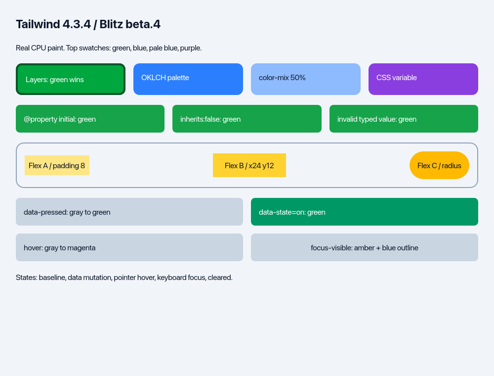
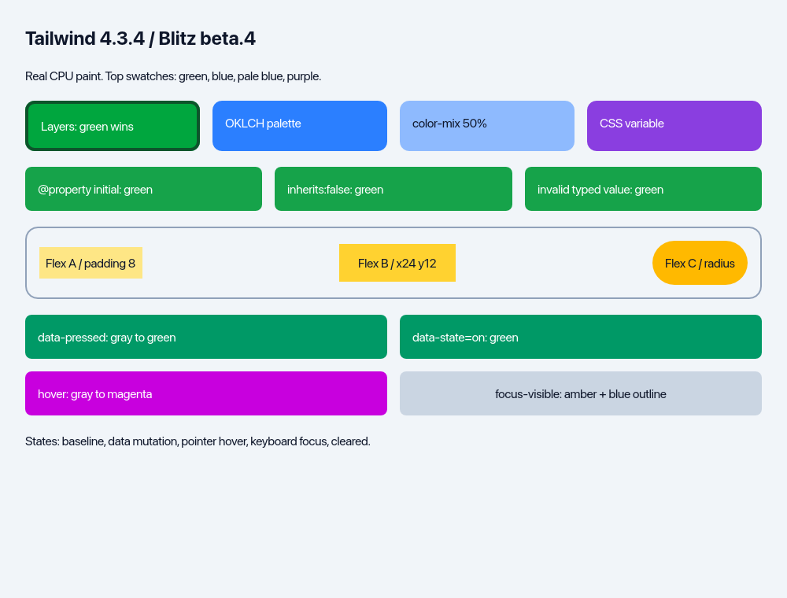
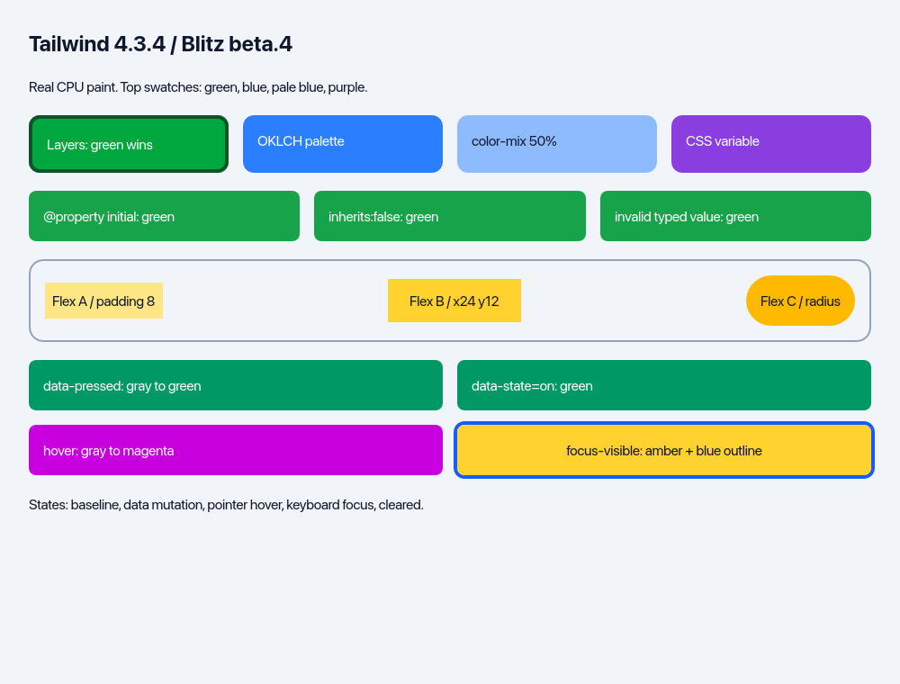

# TKM-6 — Tailwind v4 in Blitz

## Result and recommendation

**Use Tailwind v4 with one explicit native-only focus workaround.** Real compiled
Tailwind **4.3.4** renders the representative page through unmodified upstream
**Blitz 0.3.0-beta.4**, including layers, registered properties, CSS variables,
OKLCH / color-mix, flex/grid, spacing, borders, radius, data variants, and hover.
**Do not claim unmodified `focus-visible:` works.** It never matches in this Blitz
release. Do not remove focus indicators in the forthcoming UI kit.

Recommended POC policy: use `focus:` for visible focus indication on native, or
use the demonstrated native-only `@custom-variant focus-visible (&:focus);`.
This deliberately styles **all** focus, including mouse/programmatic focus; it
is not browser-equivalent keyboard-modality detection. Keep normal
`focus-visible:` semantics for a web target. If keyboard-only indication is a hard
requirement, the owner must choose a Blitz follow-up or explicit host-maintained
modality state before proceeding. No Blitz fixes or UI elements are implemented here.
Nothing found makes the overall Tailwind direction unworkable.

## Retained evidence

The fixture is [page.html](page.html), authored from scratch. [input.css](input.css)
imports the complete Tailwind theme/preflight/utilities and explicitly scans only
that page. [src/main.rs](src/main.rs) embeds the compiled CSS, parses with
`HtmlDocument`, resolves Stylo/Taffy, paints with `blitz_paint::paint_scene`, and
rasterizes using AnyRender's Vello CPU image renderer. PNGs are **actual Blitz
paint output**, not computed-style screenshots, browser emulation, or desktop
captures. There is no networking, external asset loading, or JS runtime.

| Feature | Observed result | Evidence / workaround |
| --- | --- | --- |
| `@layer` | Works | Top-left swatch green: utilities override the red components-layer rule, even though the components rule appears later in unoptimized CSS. |
| `@property` | Works for probed registration semantics | Second row: three green swatches prove initial value, `inherits:false` despite red parent, and rejection of invalid `12px` for `<color>`. Tailwind's border/outline registration also renders. Animated interpolation not tested. |
| CSS vars / `calc` | Works | Purple custom variable; inherited Tailwind theme tokens; rem spacing multiplied through `calc`. |
| OKLCH | Works visually | Blue, green, purple, amber palette swatches paint with their expected hues. Not a colorimetric/gamut-accuracy certification. |
| `color-mix` | Works | `bg-blue-500/50` paints pale blue over slate; supplemental computed style resolves the `@supports` OKLab branch with alpha 0.5, not merely an sRGB fallback. |
| Flex | Works | Three unequal padded items aligned and distributed across bordered row. |
| Grid | Works | Four equal columns, then three, then two; 16px gaps. No subgrid claim. |
| Spacing | Works | 32px body padding, 20px vertical flex gaps, 16px grid gaps; padding 8px / x24 y12 / 16px on flex children. |
| Borders / radius | Works | Dark 4px green border, 2px slate flex border, rounded corners, pill. |
| `data-[pressed]:` | Works including invalidation | State 02 inserts an empty `data-pressed` attribute through Blitz's mutator; left state swatch changes gray to green, state 05 removes it and restores gray. |
| Value data variant | Works | `data-[state=on]:` beats red base class on right state swatch. |
| `hover:` and hover media query | Works in this desktop viewport | Hit-tested coordinate via `set_hover_to` produces magenta in state 03; clearing restores gray. Tailwind retains `@media (hover: hover)`. |
| `focus-visible:` | **Broken** | State 04 has actual Tab focus on the button but no amber background or blue outline. See source cause below and native-only fallback screenshot. |

### Screenshots

Default output, before mutation:



Default output, after data mutation + hover + Tab focus. The lower-right button
is still gray: this is the failure, not a pass.



Same page and interaction with only the native focus variant override:



Each of `evidence/default`, `evidence/optimized`, and `evidence/focus-fallback`
contains five states: baseline, attribute inserted, hover, keyboard focus, cleared.
The states are cumulative until cleared. [SHA256SUMS](evidence/SHA256SUMS) records
all images and compiled stylesheets. Default vs minified images are byte-identical
for every corresponding state. State 04 equals state 03 without the workaround;
with the workaround only state 04 differs. State 05 equals baseline in all modes.
The supplemental `probe*.log` files contain rectangles, colors, borders and outline
values; **those logs alone would not prove rendering**.

### Confirmed focus cause and workaround

Published beta.4's
[`stylo.rs:478`](https://github.com/DioxusLabs/blitz/blob/v0.3.0-beta.4/packages/blitz-dom/src/stylo.rs#L478)
returns `false` for `NonTSPseudoClass::FocusVisible`, while `Focus` reads element
state. This also remains `false` in current upstream main
[`ad130c16:513`](https://github.com/DioxusLabs/blitz/blob/ad130c16ad37c84ff5f522f50ca0ea197f492b67/packages/blitz-dom/src/stylo.rs#L513)
and Fusion's pinned fork
[`2fbfd2f2:478`](https://github.com/pixelscortex/blitz/blob/2fbfd2f2fcf649d683c6f2796a5f524ce5205663/packages/blitz-dom/src/stylo.rs#L478).
A fork is not justified for this investigation.

[input.focus-fallback.css](input.focus-fallback.css) uses Tailwind's documented
custom-variant mechanism to map `focus-visible:` to `:focus`, compiled by the same
CLI. It leaves page classes unchanged and retains the normal compiled CSS for
comparison. The resulting 4px solid blue outline and amber fill are visibly
painted. No layer flattening, property stripping, variable substitution, or color
conversion step was necessary. A future Blitz issue should address selector
matching **and** keyboard/pointer modality, not merely alias focus-visible to focus.
No issue was opened or updated by this spike.

## Research and dependency selection (2026-11-06)

Researched before use with **Firecrawl live scrape (`maxAge:0`)**:

- [Tailwind CLI](https://tailwindcss.com/docs/installation/tailwind-cli): dedicated
  `@tailwindcss/cli`, import Tailwind, scan source and emit a static stylesheet.
- [Tailwind compatibility](https://tailwindcss.com/docs/compatibility): targets
  Chrome 111 / Safari 16.4 / Firefox 128; depends heavily on native variables and
  modern CSS. No documented legacy-browser switch that would fix Blitz selectors.
- [Custom variants](https://tailwindcss.com/docs/adding-custom-styles#adding-custom-variants):
  supported `@custom-variant` shorthand, used for the isolated focus fallback.
- [Blitz repository / API examples](https://github.com/DioxusLabs/blitz) and
  [CSS status](https://blitz.is/status/css): actively maintained beta with known
  missing features; flex/grid, spacing, radius and outline documented as supported.
  Status documentation is not a substitute for a version-specific render.

Used the **opensrc skill** to fetch Tailwind 4.3.4, Blitz main, published beta.4,
and the Fusion fork at its exact pin. Read Tailwind `src/variants.ts` (hover's media
query, focus-visible selector, data selectors) and Blitz screenshot, HtmlDocument,
mutator, event and selector implementation. Read, never copied, Fusion
`packages/renderer/src/lib.rs`, renderer manifest and root Cargo fork pins.
Fusion's launch uses a GPU window renderer except iOS simulator CPU; this spike
intentionally uses upstream CPU offscreen paint, not Fusion's shell or code.

`cargo info blitz-dom` reported **0.3.0-beta.4** as current published release
(MSRV 1.91); `git ls-remote` reported main
`ad130c16ad37c84ff5f522f50ca0ea197f492b67` and tag `v0.3.0-beta.4`
`560b324f8aff60a6b33ccabecb131583991fafc2`. Main uses newer Stylo git dependencies;
using the latest published upstream release avoids unneeded moving git dependencies.
Main was source-inspected, **not built/rendered**. Fusion uses beta.2 patched to
`pixelscortex/blitz@2fbfd2f2fcf649d683c6f2796a5f524ce5205663`; it was source-inspected,
**not rendered**. Do not extrapolate this result to that older pin.

Exact direct dependencies are in [Cargo.toml](Cargo.toml) and
[package.json](package.json); complete resolutions are in the spike's own locks:

- `tailwindcss` / `@tailwindcss/cli` **4.3.4** (registry latest verified; Tailwind
  package unpacked 786,416 bytes). CLI dependencies are build-time only.
- `blitz-dom`, `blitz-html`, `blitz-paint`, `blitz-traits` **0.3.0-beta.4**,
  defaults disabled for dom/html/paint; dom `system-fonts` enabled.
- `anyrender` **0.14.0**, `anyrender_vello_cpu` **0.18.0**,
  `peniko` **0.6.1**, `png` **0.18.1**, `keyboard-types` **0.8.0**.
- Important transitives: Stylo **0.22.0**, selectors **0.41.0**, Taffy **0.15.1**,
  Parley **0.12.0**, Vello CPU/common **0.3.0**, glifo **0.4.0**.

No fork patches or global tool installs. Initial dependency resolution exposed
minimum peniko/png patch requirements in current transitive dependencies; final
pins are compatible. Bun blocked an optional dependency postinstall; the CLI still
compiled all three outputs successfully without trusting/running that script.

## Reproduction and checks actually run

From repository root:

```sh
sh spikes/tailwind-blitz/run.sh
```

The script runs spike-local `bun install --frozen-lockfile`, `bun run css`,
`bun run css:optimized` (`--minify`), `bun run css:focus-fallback`,
`cargo fmt --check`, `cargo build --release --locked -j 2`, then the release
probe with no arguments, `--optimized`, and `--focus-fallback`, recording logs,
15 PNGs and SHA-256 hashes. Both `CARGO_BUILD_JOBS` and `RAYON_NUM_THREADS` are 2.
The probe verifies Tab actually reaches the button before recording focus evidence.
Debug builds/renders were also exercised; final retained evidence is from release.
No permanent tests, root checks/tests, or `moon run :size` were run: this is an
independent workspace and does not participate in the host build. Parent owns
root acceptance and integration. No commits, merges, pushes, or Linear updates.

Environment: **macOS 26.5.1 (25F80), aarch64-apple-darwin, Rust 1.97.0
(2d8144b78), Bun 1.4.4**, scale 1, light mode, 1000 × 760 viewport, system fonts.
There is no embedded font so exact text rasterization may differ on another OS.

## Size and evidence limits

- Standalone stripped size-oriented release probe: **7,375,360 bytes**. It reads
  the HTML/CSS from disk; this is not a packaged desktop binary or host-size delta.
  It includes PNG encoding and CPU rasterization, excludes shell/GPU/QuickJS/backend.
- Compiled CSS: **9,884 bytes** default; **8,315 bytes** minified;
  **8,291 bytes** minified focus fallback. No Tailwind runtime shipped.
- Supplied root host baseline **286,080 bytes is unaffected by this standalone
  spike**; no root manifests/locks/workspace or backend code were changed. A real
  integrated renderer size must be measured later, not inferred from this probe.
- Visual inspection covers the shown representative page, not all Tailwind classes,
  WPT conformance, accessibility, input editing, mobile media queries, transitions,
  gradients, shadows, container queries, subgrid, or high-DPI/gamut matching.
- This is real offscreen Blitz CPU paint, **not a live GPU window screenshot**.
  Winit, GPU/Metal presentation, Solid/QuickJS event wiring, and host integration
  remain unvalidated. Hover is driven through Blitz's coordinate/hit-test state API;
  focus is seeded on the preceding tabindex fixture then advanced by an actual
  `UiEvent::KeyDown(Tab)`. This is not an end-to-end physical keyboard/mouse test.
